


  
  <a href="https://www.linkedin.com/in/adrianjaspa"></a>
  <a href="https://x.com/Aries_Leevi"></a>
  <a href="https://adrian-js.vercel.app/Jaspa_Resume.pdf"></a>

  <a href="https://adrian-js.vercel.app"></a>
  <a href="https://codewall-rust.vercel.app/"></a>

  <a href="https://taskflow-task.vercel.app/"></a>
  <a href="https://adrian-js.vercel.app/projects"></a>

Codewall's code is at <a href="https://github.com/Aries6174/codewall">Aries6174/codewall</a>. UP: Visions was tested with 64 students.

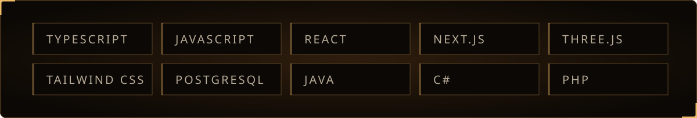


Every image here is generated by the scripts in <code>scripts/</code>.

